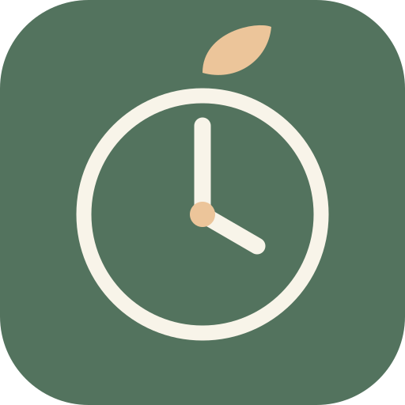
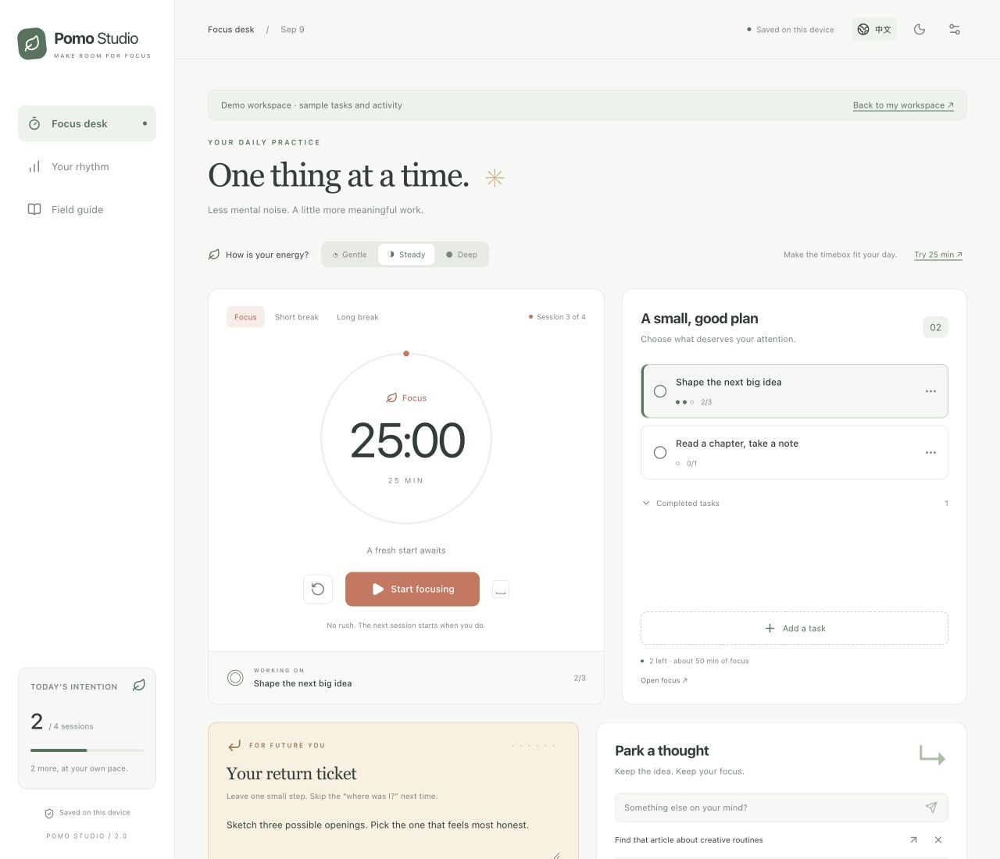
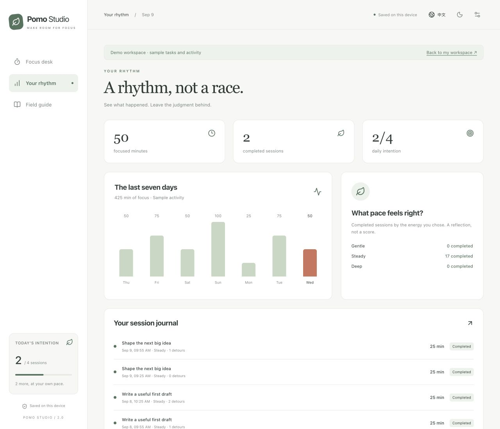
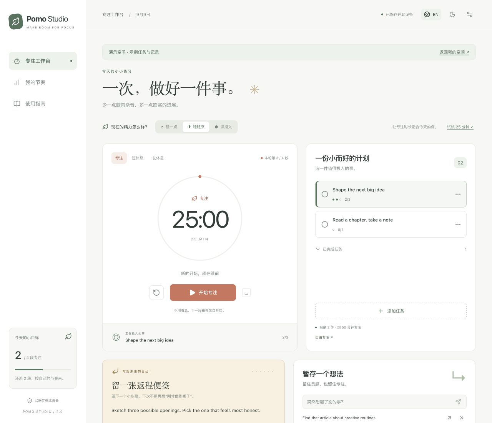
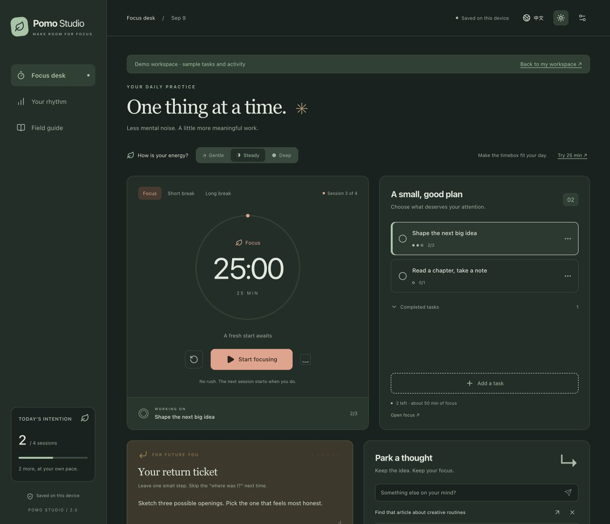
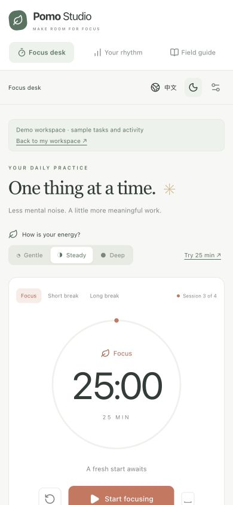
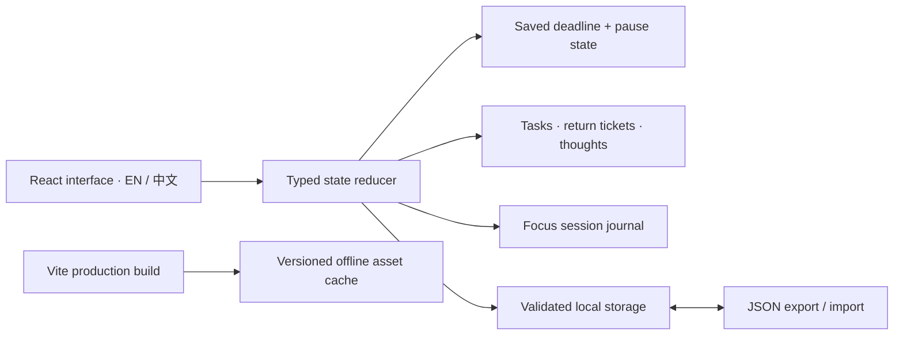

<div align="center">



# Pomo Studio

### A little room for deep work.

A calm focus timer that helps you **begin, stay with one thing, and find your way back**.

**English** · [简体中文](README.zh-CN.md)

[Getting started](#run-it-locally) · [User guide](docs/GUIDE.en.md) · [Architecture](docs/ARCHITECTURE.md) · [Publish your own](#publish-a-website)

</div>



_Real app screenshots using the separate sample workspace. The sample activity is illustrative, not a user's productivity record._

## What is this project?

This repository started as a small React Pomodoro timer: 25-minute focus sessions, 5- and 15-minute breaks, a progress ring, and a completion counter. **Version 2 turns it into a personal focus workspace**, still running entirely in your browser.

Use it when you are writing, studying, coding, or working through a project in manageable sessions. There is no account to create, API key to supply, or server to maintain.

> **A typical session:** choose “Draft the introduction” → focus for 25 minutes → park “look up that reference” without leaving the timer → write “Continue with the second example” on your return ticket → take a break.

## More than a countdown

| When this happens…                                | Pomo Studio helps you…                                                                             |
| ------------------------------------------------- | -------------------------------------------------------------------------------------------------- |
| “I forgot where I left off.”                      | **Return ticket:** save the exact next action with each task.                                      |
| “I just remembered something unrelated.”          | **Thought inbox:** park it, then turn it into a task when ready.                                   |
| “Twenty-five minutes feels wrong today.”          | **Energy fit:** try Gentle / Steady / Deep at 15 / 25 / 45 minutes without changing your defaults. |
| “I'm in flow, but the timer is almost done.”      | **Flow extension:** add five minutes, up to two hours total.                                       |
| “I need to stop early.”                           | **Honest accounting:** save partial focus time without counting it as a completed session.         |
| “I want perspective without a streak to protect.” | **Your rhythm:** review seven days, session details, and the pace you chose.                       |

These features are practical design choices, not claims that no other product has ever considered them.

### Everyday essentials

- Custom focus and break lengths: **1–120 minutes**; long break every **2–12 completed focus sessions**.
- Task selection, session estimates, editing, completion, and a remaining-plan estimate.
- A saved end time that survives refreshes and reconciles after background suspension.
- Pause/resume, reset confirmation, and manual starts for every next phase.
- A daily session intention and a journal of completed and early-finished focus sessions.
- English / 简体中文 throughout the interface; light and dark themes; responsive mobile layout.
- Optional completion chime and browser notifications where supported.
- Local saving, validated JSON backups, import review, and recovery for unreadable data.
- One editing tab per workspace where the browser supports Web Locks.
- An experimental production offline cache with visible installation status. Offline reload still needs verification in your target browser; see the [validation notes](docs/ARCHITECTURE.md#deployment-and-offline-cache).

## See your rhythm



Time totals include partial work. Daily goals and task progress count **fully completed focus sessions only**. Breaks do not add focus time. Finishing the timer does not automatically mark its task done.

<details>
<summary><strong>Chinese interface, dark theme, and mobile preview</strong></summary>







Changing the interface language preserves your task titles and notes exactly as written.

</details>

## Run it locally

Use **Node.js 24 LTS** and npm. Node 22.12+ is also supported by the declared engine range; development verification was performed with Node 25.3.

```bash
git clone https://github.com/Jack-Li-Npu/pomodoro-timer.git
cd pomodoro-timer
npm ci
npm run dev
```

Open the local URL printed by Vite, usually `http://localhost:5173`.

**Want to look around first?** Add `?demo=1` to that URL. It opens sample tasks and a week of activity in a separate workspace. The in-app **Field guide → Explore a sample workspace** link does the same thing.

### Your first two minutes

1. Click **Add a task**. Name one concrete action and estimate the number of focus sessions.
2. Select an energy level. Optionally click **Try … min** to fit this session to it.
3. Click **Start focusing**. Press **Space** to pause or resume when you are not typing or using another control.
4. Put unrelated ideas in **Park a thought**. The timer keeps running.
5. Before leaving, write your next action in **Your return ticket**.
6. Let the timer finish, or choose **Finish early**. Select the suggested break and start it when ready.

For screenshots, backup instructions, and troubleshooting, see the [full English guide](docs/GUIDE.en.md) or [中文使用指南](docs/GUIDE.zh-CN.md).

## Build and verify

```bash
npm test            # Behavior tests for timing, recovery, tasks, language, and import
npm run typecheck   # Strict TypeScript check
npm run build       # Type check + optimized dist/ + generated offline cache
npm run preview     # Serve dist/ locally; use this to test the production app
```

The development server does not register a service worker. Serve `dist/` over HTTPS, or localhost for local testing; opening `index.html` with `file://` is not supported.

## Publish a website

The repository includes a **manual GitHub Pages workflow**. A public repository alone does not publish the app as a website.

1. In your repository, open **Settings → Pages**.
2. Select **GitHub Actions** as the source.
3. Open **Actions → Deploy to GitHub Pages → Run workflow** and choose `master`.
4. Open the deployment URL shown by the successful run.

For this repository, the expected address is `https://jack-li-npu.github.io/pomodoro-timer/` **after a successful deployment**. It is not presented here as an already-live demo. Run the workflow again when you want to publish an update.

You can also deploy the generated `dist/` directory to another static host. The relative asset base supports a repository subpath. [Deployment and offline details →](docs/ARCHITECTURE.md#deployment-and-offline-cache)

## Your data and practical limits

- Data stays in this browser's local storage. The app sends no task content to a backend and includes no analytics or external fonts. Your hosting provider can still receive ordinary requests for the app files.
- Storage belongs to the **origin and browser profile**, not your GitHub account. `localhost`, `127.0.0.1`, different ports, and a deployed website have separate workspaces. Export/import to move your work.
- Clearing site data, using private browsing, or switching devices can remove or separate your workspace. **Export a backup first.** Backups contain your task titles and notes in plain text.
- Limits: 500 tasks, 500 parked thoughts, and the latest 5,000 focus sessions. Import files must be valid version-1 backups and no larger than 5 MB. Export periodically if you need a longer archive.
- A browser cannot guarantee an alarm while closed, suspended, or restricted by the operating system. On return, an elapsed timer records one finished session; it does not invent unattended cycles. Changing the system clock affects the countdown.
- Offline availability depends on successful service-worker installation and retained browser cache. Installation and notification options vary by browser. Without Web Locks, use one editing tab at a time.

## How it is built



**React 18 · TypeScript · Vite · react-i18next · Lucide · plain CSS · Vitest**

The former Tailwind configuration was replaced with a small, dedicated CSS design system. The timer and storage rules live outside React so they can be tested independently. Read the [architecture map](docs/ARCHITECTURE.md) to find the code for a feature.

## Contributing

Keep changes focused and describe the user-facing behavior. Run `npm test` and `npm run build` before opening a pull request. New UI text belongs in both locale files, and timer/storage changes need behavior tests. Please use sample data in screenshots and never commit personal backups.

Licensed under [MIT](LICENSE), matching the original project's license declaration.
