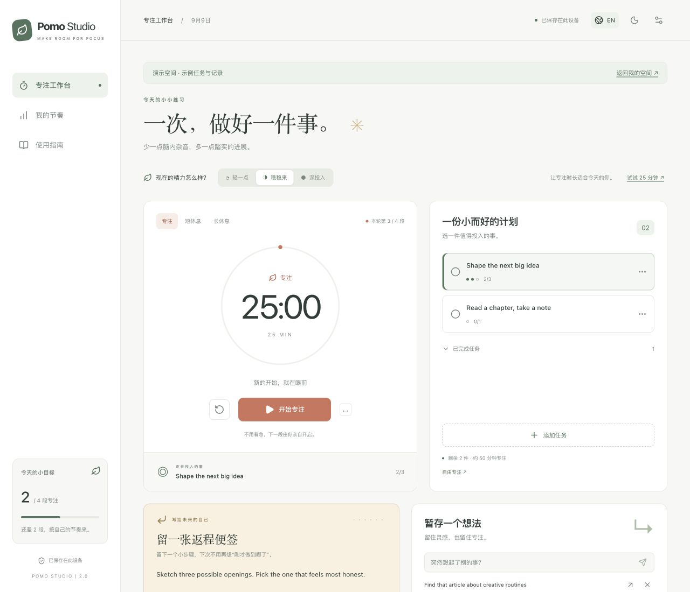
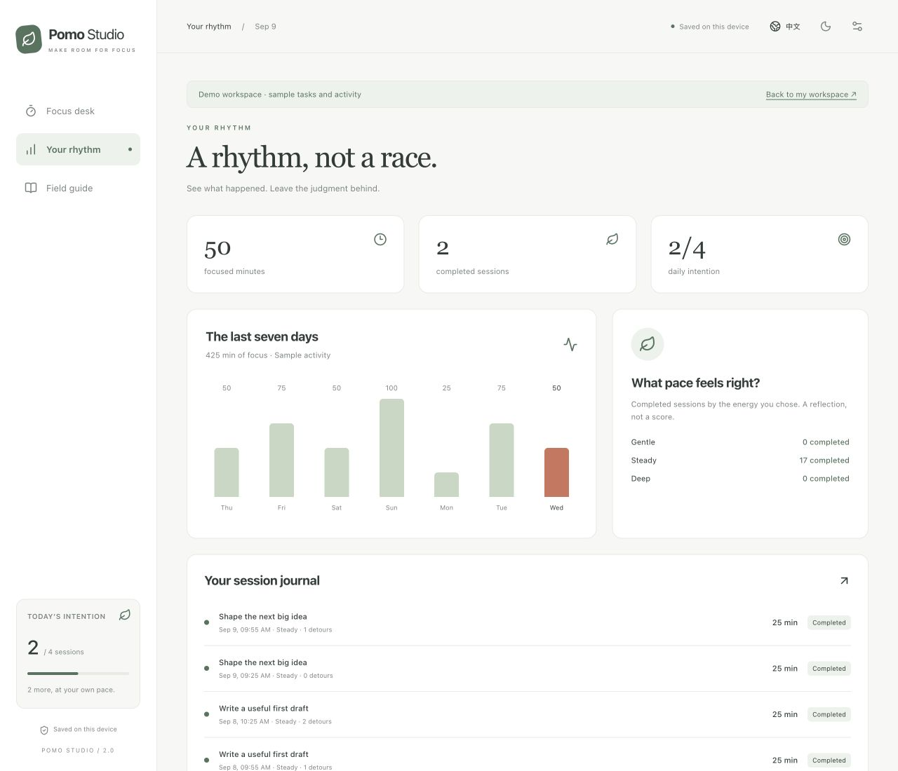
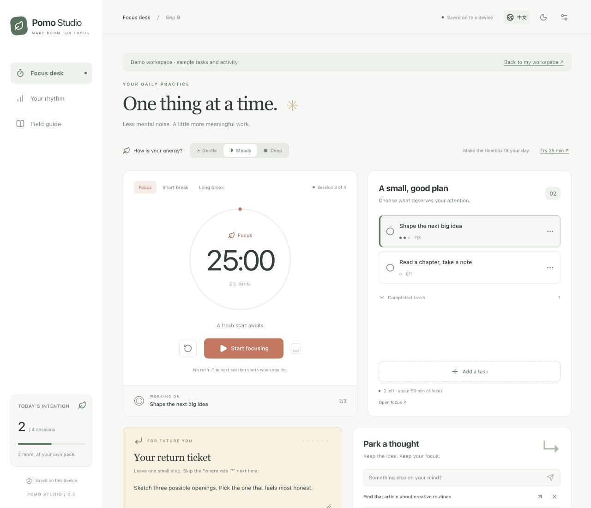
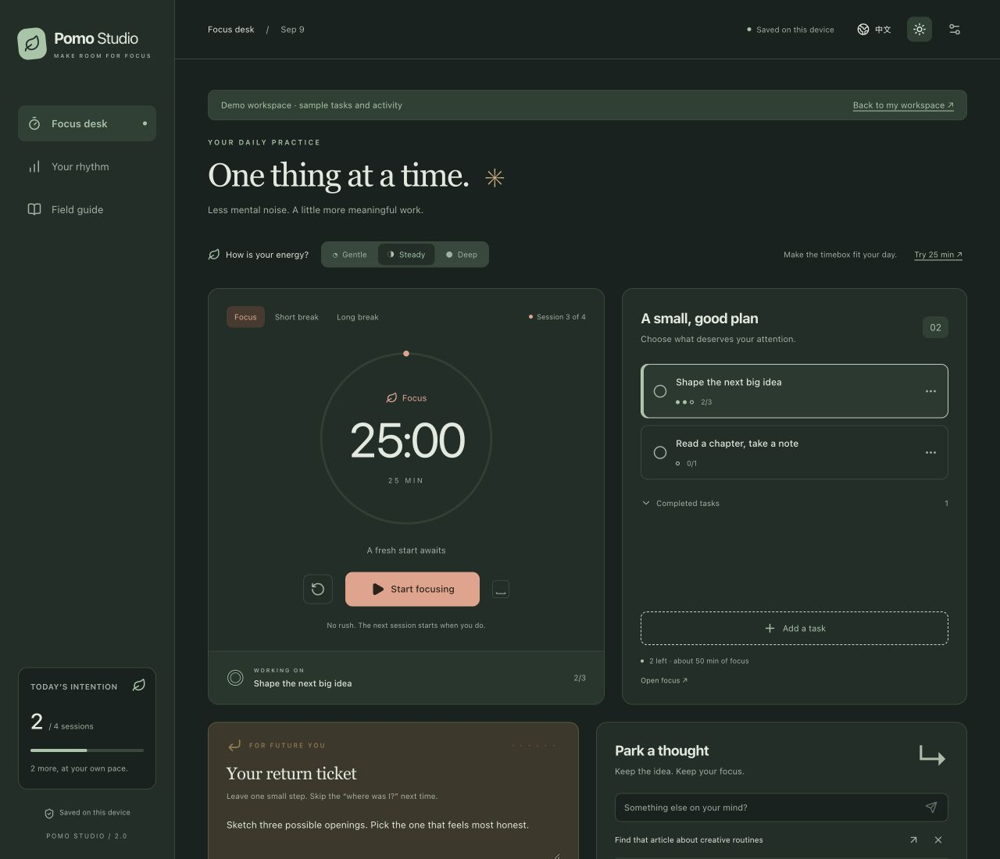
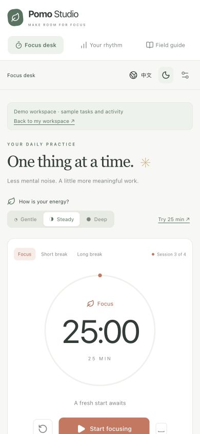
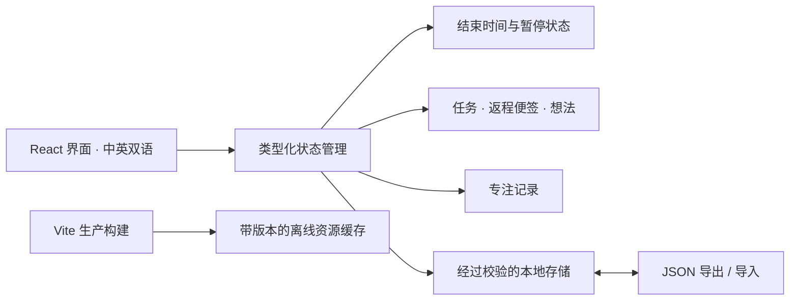

<div align="center">


# Pomo Studio

### 给专注，留一点空间。

一个安静的番茄钟工作台，帮你**开始一件事，专注一会儿，下次顺利接着做**。

[English](README.md) · **简体中文**

[本地运行](#本地运行) · [完整使用指南](docs/GUIDE.zh-CN.md) · [项目架构](docs/ARCHITECTURE.md) · [发布网站](#发布成网站)

</div>



_截图来自真实应用的独立演示空间。任务与历史记录均为示例，不代表任何人的实际工作记录。_

## 这个项目是做什么的？

它最初是一个简单的 React 番茄钟：25 分钟专注、5 分钟短休息、15 分钟长休息，以及进度环和完成计数。**2.0 版本把它扩展成个人专注工作台**，仍然完全在浏览器里运行。

写文章、学习、编程，或者推进一个总觉得无从下手的项目，都可以从一段小小的专注开始。无需注册账号、填写 API Key，也不用搭建后端。

> **一次实际使用：**选中“写引言” → 专注 25 分钟 → 突然想起“查一篇参考文献”，先暂存 → 结束前记下“接着补第二个例子” → 休息，下次回来直接继续。

## 不只是倒计时

| 遇到这样的时刻……                     | 可以这样处理                                                                         |
| ------------------------------------ | ------------------------------------------------------------------------------------ |
| “我忘了上次做到哪了。”               | **返程便签：**给每个任务留下具体的下一步，回来就能接上。                             |
| “突然想起一件不相关的事。”           | **想法暂存：**先记下来，不中断计时；休息时再转成任务。                               |
| “今天不太适合 25 分钟。”             | **精力适配：**轻一点 / 稳稳来 / 深投入，分别建议 15 / 25 / 45 分钟，不修改默认设置。 |
| “快响铃了，但现在状态正好。”         | **顺势加时：**每次增加 5 分钟，总时长最多两小时。                                    |
| “必须提前结束了。”                   | **如实记录：**保存已经投入的时间，同时明确标记为提前结束。                           |
| “想回顾一下，但不想被连续打卡绑住。” | **我的节奏：**看看最近七天、每次专注和自己选择的精力档位。                           |

这些是围绕实际使用场景做出的设计，不宣称“全球首创”或“其他产品从未想到”。

### 日常功能也齐全

- 专注与休息均可设为 **1–120 分钟**；每完成 **2–12 段专注**，建议一次长休息。
- 添加、选择、编辑、完成任务；估算专注次数与剩余计划时间。
- 使用保存的结束时间计时，刷新后可恢复，后台挂起后回来会校准。
- 暂停 / 继续、重置确认；每一段都由你手动开始。
- 每日小目标，以及区分“完成”和“提前结束”的专注记录。
- 全界面英文 / 简体中文切换、明暗主题、手机适配。
- 可选提示音和浏览器通知，是否可用取决于浏览器及系统权限。
- 本地保存、JSON 备份、导入前检查与确认、异常数据恢复入口。
- 支持 Web Locks 的浏览器中，同一空间只允许一个标签页编辑。
- 生产版本包含实验性离线缓存及安装状态；目标浏览器的离线重载仍需验证，见[验证说明](docs/ARCHITECTURE.md#deployment-and-offline-cache)。

## 看见自己的节奏



专注总时长包含提前结束的实际投入；每日目标和任务进度只计算**完整完成的专注段**。休息不计入专注时长，完成一段计时也不会自动把任务标记为完成。

<details>
<summary><strong>看看英文界面、深色主题和手机版</strong></summary>







切换语言只改变界面文案，不会翻译或覆盖你写下的任务和笔记。

</details>

## 本地运行

建议使用 **Node.js 24 LTS** 和 npm。项目声明也支持 Node 22.12+；本次开发验证使用 Node 25.3。

```bash
git clone https://github.com/Jack-Li-Npu/pomodoro-timer.git
cd pomodoro-timer
npm ci
npm run dev
```

打开终端里 Vite 显示的地址，通常是 `http://localhost:5173`。

**想先看效果？** 在地址后加上 `?demo=1`，即可进入带有示例任务和一周记录的演示空间。应用内也可以通过 **使用指南 → 体验示例空间** 进入。演示数据与个人空间分开保存。

### 两分钟上手

1. 点击 **添加任务**，写一个具体动作，估算需要几段专注。
2. 选择精力档位；愿意的话，点击 **试试 … 分钟**，仅调整这一次。
3. 点击 **开始专注**。不在输入框或其他控件中时，可用 **空格键**暂停或继续。
4. 想到别的事，写进 **暂存一个想法**，计时继续走。
5. 离开前，在 **返程便签**里留下一步要做什么。
6. 等计时结束，或选择 **提前结束**；选择建议的休息阶段，准备好了再开始。

更详细的操作、备份方法和常见问题见 [中文使用指南](docs/GUIDE.zh-CN.md)；也提供 [English guide](docs/GUIDE.en.md)。

## 构建与验证

```bash
npm test            # 计时、恢复、任务、语言和导入的行为测试
npm run typecheck   # 严格 TypeScript 检查
npm run build       # 类型检查、生成 dist/，并生成离线缓存脚本
npm run preview     # 本地预览生产构建
```

开发服务器不会注册 service worker。正式使用请通过 HTTPS 提供 `dist/`，本地测试可用 localhost；不支持直接以 `file://` 打开 `index.html`。

## 发布成网站

仓库自带**手动运行的 GitHub Pages 工作流**。仓库公开之后，仍需部署才能获得可直接使用的网站。

1. 打开仓库 **Settings → Pages**。
2. 将来源设为 **GitHub Actions**。
3. 进入 **Actions → Deploy to GitHub Pages → Run workflow**，选择 `master`。
4. 部署成功后，打开运行结果中的网站地址。

本仓库部署成功后的预期地址为 `https://jack-li-npu.github.io/pomodoro-timer/`。这里没有把它当作已经上线的演示链接。以后需要更新网站时，再运行一次该工作流。

也可以将 `dist/` 部署到其他静态托管服务。资源使用相对路径，支持仓库子路径部署。[查看部署和缓存原理 →](docs/ARCHITECTURE.md#deployment-and-offline-cache)

## 数据保存在哪里？有哪些限制？

- 数据存在当前浏览器的本地存储中。应用没有收集任务内容的后端、统计追踪或外部字体；托管平台仍会收到正常的网页资源请求。
- 数据按**网站来源和浏览器配置**分开，而不是跟着 GitHub 账号走。`localhost`、`127.0.0.1`、不同端口及正式网站都有各自的空间。迁移请使用导出 / 导入。
- 清除网站数据、使用无痕模式或更换设备，可能导致数据丢失或隔离。**请先导出备份。** 备份中的任务和笔记为明文，分享前自行检查。
- 最多保留 500 个任务、500 条暂存想法、最近 5,000 段专注记录；导入文件须为有效的版本 1 备份，且不超过 5 MB。需要长期归档时，请定期导出。
- 浏览器关闭、系统休眠或后台受限时，无法保证准时响铃。回来后会记录已经结束的那一段，不会自动补出无人参与的多个循环。修改系统时间也会影响倒计时。
- 离线使用需要成功安装 service worker 且缓存未被清理；安装入口和通知支持随浏览器而异。不支持 Web Locks 时，请只用一个标签页编辑。

## 项目框架速览



**React 18 · TypeScript · Vite · react-i18next · Lucide · 原生 CSS · Vitest**

原来的 Tailwind 配置已替换为专用 CSS 样式。计时与存储逻辑独立于 React，便于验证和扩展。想找某个功能从哪里实现，请看 [架构说明](docs/ARCHITECTURE.md)。

## 参与改进

提交改动前运行 `npm test` 和 `npm run build`。新增界面文案需同时补齐中英文；修改计时或存储规则时，请补充对应行为测试。截图使用示例数据，不要提交个人备份。

采用 [MIT 许可证](LICENSE)，与原项目 README 的许可声明一致。
