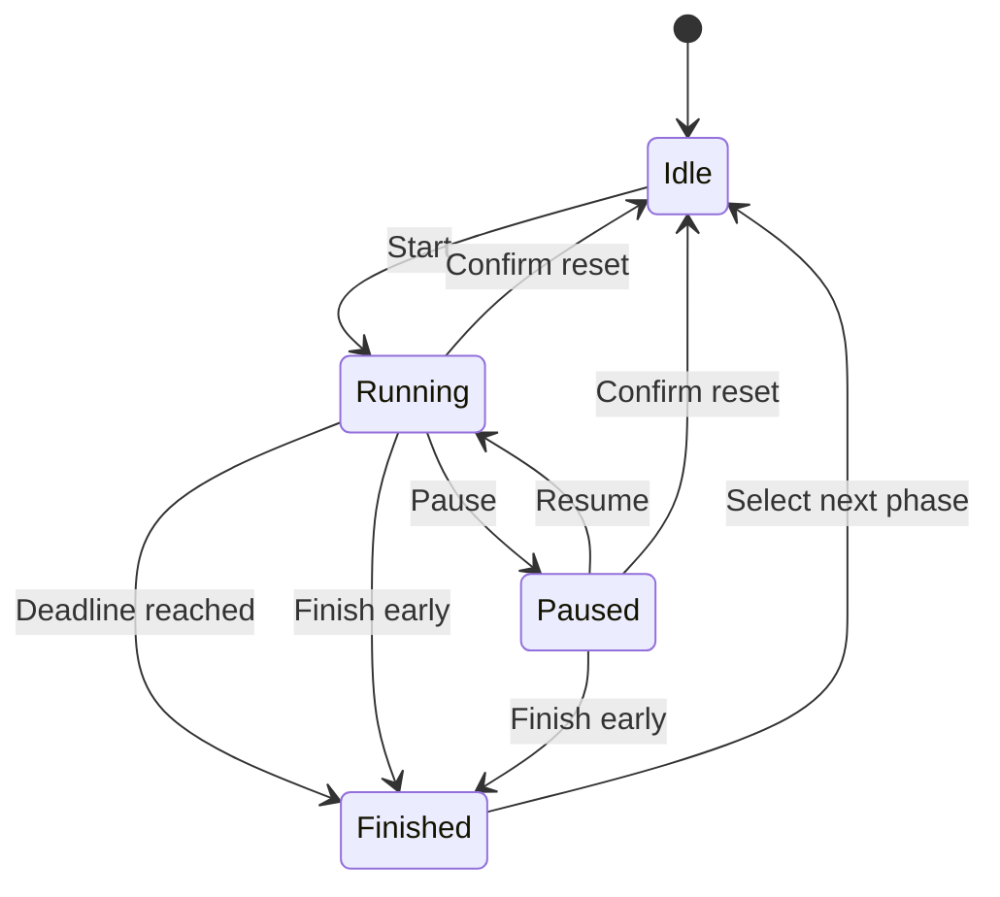

# Architecture / 项目架构

[English introduction](../README.md) · [中文介绍](../README.zh-CN.md)

## The framework in one minute / 一分钟看懂框架

Pomo Studio is a static React app. It has no database server, API service, authentication, or AI integration. The browser owns a typed workspace containing settings, tasks, notes, a timer, and focus-session history.

这是一个静态 React 应用，没有数据库服务器、接口服务、登录系统或 AI 接口。设置、任务、便签、计时和历史记录都在浏览器中管理。

| File / 文件                         | Responsibility / 职责                                                                                                     |
| ----------------------------------- | ------------------------------------------------------------------------------------------------------------------------- |
| `src/App.tsx`                       | Navigation, workspace wiring, language/theme, keyboard shortcuts and completion alerts / 页面组织、状态连接、快捷键、提醒 |
| `src/lib/model.ts`                  | Types, pure reducer, deadline arithmetic, completion accounting / 数据类型、纯状态更新、计时与统计规则                    |
| `src/lib/storage.ts`                | Version-1 validation, restoration and sample fixtures / 备份校验、恢复、演示数据                                          |
| `src/hooks/useWorkspace.ts`         | Persistence, Web Locks ownership, cross-tab synchronization and reconciliation / 本地保存、标签页互斥与同步、到期校准     |
| `src/hooks/useOffline.ts`           | Service-worker registration and visible installation status / 离线脚本注册与状态                                          |
| `src/components/TimerPanel.tsx`     | Time display, modes and controls / 计时显示与操作                                                                         |
| `src/components/TaskPanel.tsx`      | Task planning and editing / 任务计划与编辑                                                                                |
| `src/components/DeskNotes.tsx`      | Return tickets and thought inbox / 返程便签与想法暂存                                                                     |
| `src/components/Rhythm.tsx`         | Local-calendar summaries and session journal / 本地日期统计与记录                                                         |
| `src/components/SettingsDialog.tsx` | Settings and reviewed backup replacement / 设置与备份导入确认                                                             |
| `src/components/Guide.tsx`          | Built-in onboarding / 应用内说明                                                                                          |
| `src/locales/default/{en,zh}.ts`    | English and Chinese copy; Chinese keys checked against English / 中英文文案及键名校验                                     |
| `src/index.css`                     | Responsive layout, themes and reduced-motion rules / 响应式、主题与减少动画                                               |
| `scripts/build-sw.mjs`              | Build-specific static asset cache / 每个构建版本的静态资源缓存                                                            |
| `tests/`                            | Vitest and React Testing Library behavior tests / 行为测试                                                                |

## Timer rules / 计时规则



While running, `remaining = max(0, min(durationMs, deadline − now))`. Intervals request reconciliation; they do not decrement a seconds counter. The display updates once a second, and the owning workspace checks completion every 250 ms while running, plus on focus/visibility changes.

暂停保存剩余毫秒数，并清空结束时间；继续时重新计算结束时间。运行中使用绝对结束时间，因此后台节流不会让倒计时逐渐变慢，但系统时间变化会影响它。

- Session IDs make completion idempotent: returning after a long absence saves one session, not a chain of unattended sessions.
- Completed focus advances the cycle; partial focus contributes time but not completion count.
- Pauses do not contribute focus seconds. Extension adds the same amount to duration and remaining time/deadline.
- Current-task edits and selection are locked while active. Session history keeps its own task-title snapshot.
- A completed long break resets the cycle. Next phases are always idle until explicitly started.
- Session totals use the local date of `endedAt`; a session crossing midnight is not split across dates.

## Data contract / 数据约定

The workspace is versioned with `version: 1`, independent of the app's `2.0.0` version. `parseState` validates bounds, enum values, references, duplicate IDs and timer consistency before accepting a backup. Future incompatible changes need an explicit migration.

工作区使用 `version: 1`，与应用版本号分开。未来变更存储结构时，应增加明确的数据迁移，而不是直接覆盖旧数据。

- Normal key: `pomo-studio:v1`.
- Sample key: `pomo-studio:demo:v2`; `?demo=1` opts into this isolated sample workspace.
- At most 500 tasks, 500 inbox thoughts, and the most recent 5,000 focus sessions.
- Import max: 5 MB. Import replaces the whole workspace only after review.
- Export pauses a running timer in the exported copy. It does not pause the original timer.
- Invalid stored data disables writes until explicit replacement; users can download the raw value.
- Storage failures show a warning. There is no claim that local browser storage is a durable cloud backup.

A Web Lock with the workspace key gives one tab editing ownership. Waiting tabs follow storage events, then reload the latest state when the owner releases its lock. In browsers without Web Locks, the app remains usable, but the user should keep a single editing tab.

Web Locks 用于确保同一个空间只有一个标签页写入。等待中的页面通过 storage 事件跟随更新；接管时重新读取最新状态。不支持该接口的浏览器仍可用，但应避免多标签页同时编辑。

## Deployment and offline cache

`npm run build` creates `dist/`, then hashes the build contents and generates `dist/sw.js`. The cache includes the HTML, bundled scripts/styles, icon and manifest. It is scoped to the deployment path. Navigation uses cached HTML so that the HTML and hashed assets stay on the same build. New workers wait for old tabs to close; there is no forced mid-session reload.

构建后生成与该版本绑定的离线缓存，按部署路径隔离。新版等待旧标签页关闭后接管，避免正在专注时强制刷新，也避免 HTML 与资源版本不匹配。

Offline installation requires HTTPS or localhost and browser support. **The Field guide displays installation status. Installation alone is not a substitute for an offline test on the target browser.** During development validation, installation reported ready in the embedded browser, but reloading with the local server stopped produced a blank page. Offline reload is therefore not verified for that embedded environment; use an ordinary supported browser and check it before relying on offline availability.

离线安装要求 HTTPS 或 localhost 以及浏览器支持。**使用指南会显示安装状态，但安装成功不等于目标浏览器已通过离线验证。** 本次内嵌浏览器测试显示安装完成，但关闭本地服务器后刷新出现空白，因此该环境的离线重载尚未验证通过。请在日常使用的浏览器中先验证，再依赖离线功能。

The GitHub Pages workflow is deliberately manual:

1. Configure Pages source as GitHub Actions.
2. Run **Deploy to GitHub Pages** on `master`.
3. Wait for the deployment result; repository visibility does not automatically enable a website.

`base: './'` supports repository subpaths. To host elsewhere, upload the **contents** of `dist/` to a static HTTPS host. Keep each deployment atomic where possible. Avoid caching `sw.js` indefinitely at the CDN layer.

## Validation / 验证

Run:

```bash
npm ci
npm test
npm run build
```

The test suite covers deadline restoration, pause exclusion, extension at expiry, long-break cycles, partial work, settings during active work, task attribution, return tickets, detour counts, malformed backups, calendar boundaries, bilingual persistence, keyboard behavior and import review.

Browser checks performed during this update:

- English and Chinese interface, light/dark themes, sample workspace and activity journal.
- Responsive widths 1280, 390 and 320 CSS pixels; no horizontal overflow at the mobile widths.
- Task creation, saved return ticket, running timer and pause surviving refresh.
- Second-tab editing disabled; ownership handed over after closing the first tab.
- Production offline installation status displayed; embedded offline reload limitation described above.

Physical-device notifications, desktop installation UI, and all browser/OS combinations have not been exhaustively tested. CI runs the automated suite and production build with Node 24.

## Safe extension points / 如何继续扩展

- Add an action and test to `model.ts` for new timer or task rules. Keep clock reads in callers so tests can supply exact times.
- Add strings to both locale files; keep user-authored content unchanged when switching languages.
- If adding cloud sync later, define ownership/conflict rules and explicit opt-in before sending task content off-device.
- If increasing storage limits, revisit localStorage quota and backup size together. Long archives belong in a more suitable storage layer.
- Keep sample fixtures separate from real data and label their screenshots as examples.
