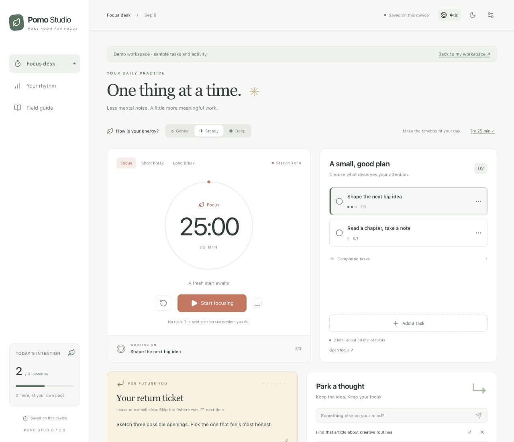
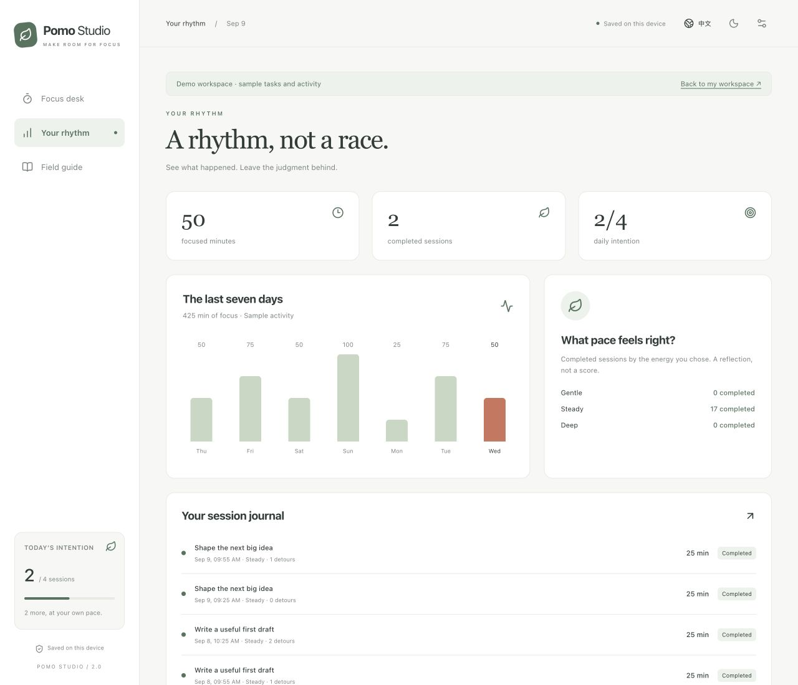

# Your first week with Pomo Studio

[English](GUIDE.en.md) · [简体中文](GUIDE.zh-CN.md) · [Back to the project](../README.md)

## 1. Give the session a small job

Click **Add a task** and name an action you can begin now: “Write the opening paragraph” is easier to start than “Finish the report.” Set an estimate of 1–20 focus sessions. Select the task by clicking its title.

The dots show completed focus sessions against your estimate. Estimates are a planning aid, not a limit. Use the task’s **…** button to edit or delete it. Mark the task done yourself when the actual work is complete.

To work without a task, choose **Open focus** beneath the plan. During an active session, task selection and edits to the current task are locked so its time stays attached to the right work.

## 2. Pick a pace, then begin

The normal focus length is 25 minutes. **Settings** lets you change the default durations, the long-break interval, and your daily intention.

For a one-off change:

| Energy | Suggested time | Example                                         |
| ------ | -------------- | ----------------------------------------------- |
| Gentle | 15 min         | Open the document and write a rough paragraph.  |
| Steady | 25 min         | Work through one exercise or a small feature.   |
| Deep   | 45 min         | Stay with a longer piece of uninterrupted work. |

Clicking an energy level records your chosen pace; **Try … min** actually applies its suggested duration. It is available before starting a session. Changing energy during a running session only sets the choice for your next session.

Press **Start focusing**. Space starts, pauses, or resumes the timer when focus is on the page itself. Shortcuts ignore text fields, buttons, links, and open dialogs. Esc closes a dialog.

## 3. Keep the thought without following it

Use **Park a thought** for something that interrupts you: an errand, an interesting link to find, or a question for later. Submit it with Enter or the paper-plane button.

- The clock keeps running.
- The arrow turns the thought into a one-session task.
- The × dismisses it.
- The session journal counts thoughts captured during that session, even if you later promote or dismiss them.

This is a manual reflection tool. It does not monitor your screen, attention, or other apps.

## 4. Leave a return ticket

Write one concrete next step before stopping:

> “Open the outline. Add the example about browser tabs under section 2.”

Each task keeps its own note. Open focus has a separate note. Selecting another task shows its note automatically. Notes save as you type; watch for a storage warning if your browser cannot save them.

## 5. Finish honestly and rest

| Action             | What happens                                                                                     |
| ------------------ | ------------------------------------------------------------------------------------------------ |
| Pause              | Freezes the remaining time; paused time is excluded.                                             |
| Resume             | Starts a new deadline from the remaining time.                                                   |
| +5 min of flow     | Adds five minutes to the active focus session, up to 120 minutes total.                          |
| Finish early       | Saves elapsed focus seconds as a partial session; does not advance your completed-session count. |
| Reset              | Asks before discarding an active session; its unfinished time is not saved.                      |
| Timer reaches zero | Saves one completed focus session and offers the next phase.                                     |
| Next: …            | Selects the suggested phase; you still press Start to begin it.                                  |

After the configured number of fully completed focus sessions, a long break is suggested. Completing a long break resets the cycle. Breaks are not recorded as focus sessions. A session shorter than one second is not added to the journal; displayed minute totals are rounded.

A timer that expires while the page is unavailable is reconciled when you return. Its history date is its scheduled end time, not the time you reopened the browser. A session spanning midnight is assigned to the local date on which it ended.

## 6. Review without scoring yourself

**Your rhythm** shows today’s minutes, completed sessions, your daily intention, and the last seven local calendar days. Partial work contributes minutes; only complete sessions advance the daily intention and task progress.

Energy counts reflect the pace you chose at the start of each session. They are not an automatic assessment or recommendation. Deleted tasks remain recognizable in history through the title saved with each session.

## 7. Back up before moving

Open **Settings → Export backup**. Save the JSON somewhere you control.

To restore or move devices:

1. Finish or reset an active session in the destination workspace.
2. Open **Settings → Import backup** and select the JSON file.
3. Check the task, session, and thought counts shown in the review.
4. Export the destination workspace too if you want to keep it.
5. Click **Replace with this backup**. The import replaces rather than merges.

A running timer is paused when exported. Imported running timers are also paused. A backup includes settings and notes, so it may change the interface language/theme after import. Treat it as a personal document, not a file to commit to GitHub.

If saved data cannot be read, the app stops overwriting it and offers a raw download. Keep that file before starting fresh or importing a valid backup. A storage-unavailable warning means persistence is not guaranteed, even if the current page is usable.

## Browser notes

- **No alarm?** Enable sound in Settings, interact with the page, and check the device’s volume. Notifications require permission and browser support. Neither is guaranteed while the browser is closed or the device sleeps.
- **Another tab owns the workspace?** Close that tab; the waiting tab takes over automatically. This protection uses Web Locks. Without that API, use a single editing tab.
- **A different browser looks empty?** Browser profiles, origins, and ports keep separate storage. Use export/import to move data.
- **Offline use:** run the production build over HTTPS or localhost. In **Field guide**, look for **Offline files are ready in this browser** before relying on the cache. Some embedded browsers restrict service workers. Development mode explicitly disables this cache.
- **Installing the app:** use your browser’s install or Add to Home Screen option when available. Installability depends on browser/platform support.
- **After an update:** close all app tabs, then reopen the site. A newly installed service worker waits for the older version’s tabs to close, keeping each build’s HTML and assets together.

[Read the code map](ARCHITECTURE.md) · [Back to README](../README.md)
