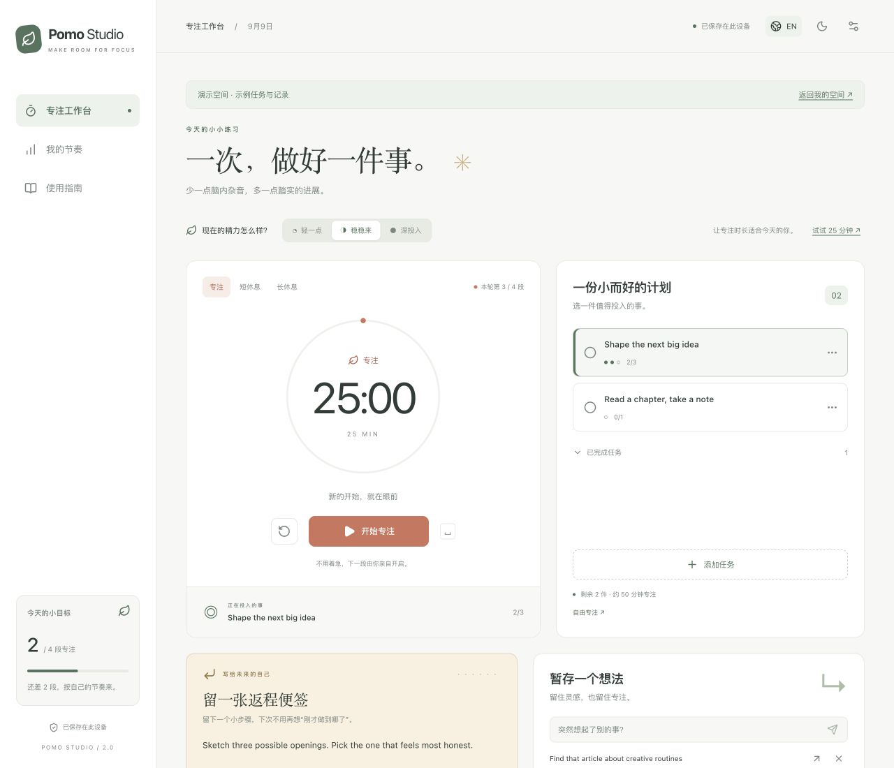
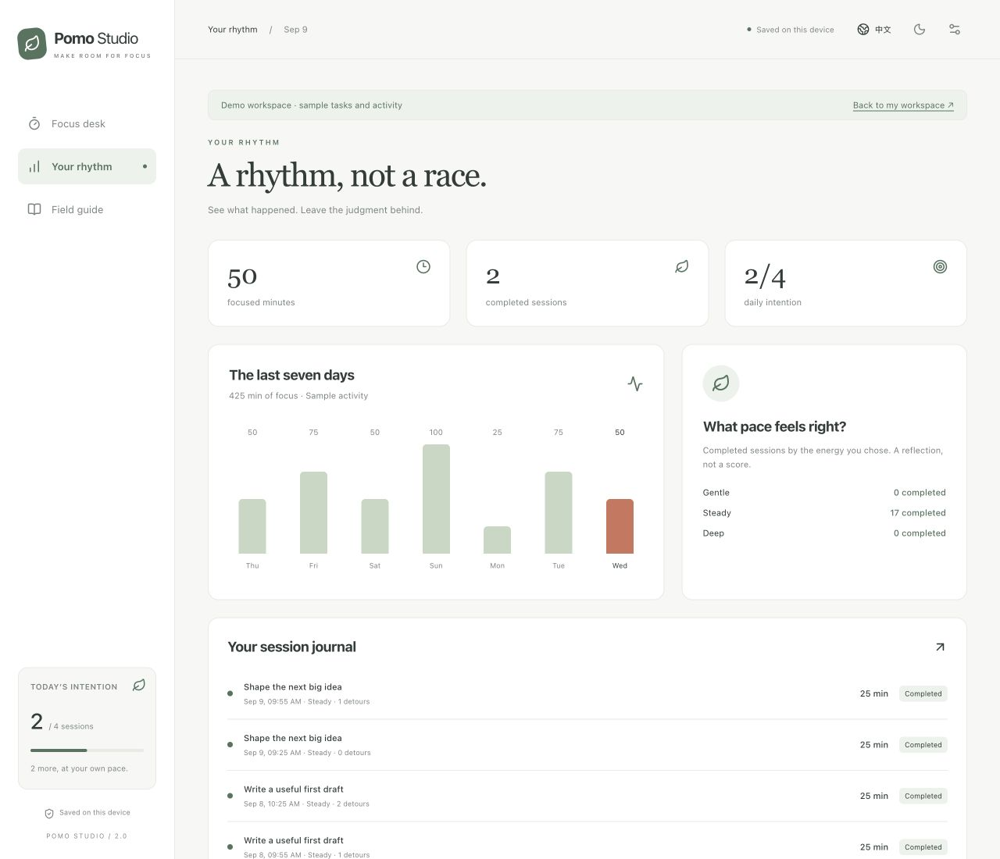

# 从第一段专注开始

[English](GUIDE.en.md) · [简体中文](GUIDE.zh-CN.md) · [返回项目介绍](../README.zh-CN.md)

## 1. 给这段时间一件小事

点击 **添加任务**，写一个现在就能动手的动作。“写出第一段”通常比“完成整份报告”更容易开始。估算需要 1–20 段专注，然后点击任务标题选中它。

任务下的小圆点表示已完成次数与估算次数。估算只是参考，不会限制你继续工作。点击任务右侧的 **…** 可以编辑或删除；实际工作做完以后，再手动标记任务完成。

不想绑定任务时，点击计划下方的 **自由专注**。计时开始后，暂时不能更换任务或编辑当前任务，以免把时间记到别的事情上。

## 2. 找到今天合适的节奏

默认专注时长为 25 分钟。**设置**中可以修改默认时长、长休息间隔和每日目标。

只想调整这一次时，可以用精力档位：

| 精力   | 建议时长 | 可以做的事                       |
| ------ | -------- | -------------------------------- |
| 轻一点 | 15 分钟  | 打开文档，先写一小段草稿。       |
| 稳稳来 | 25 分钟  | 做一道练习，或者实现一个小功能。 |
| 深投入 | 45 分钟  | 连续处理一段需要保持思路的工作。 |

点击档位表示选择精力；点击 **试试 … 分钟** 才会应用建议时长，且只能在开始前应用。如果在计时中改变档位，会用于下一段，不改变当前记录的精力标签。

点击 **开始专注**。焦点在页面本身时，空格键可以开始、暂停或继续；输入框、按钮、链接及弹窗中的操作不会触发该快捷键。Esc 可关闭弹窗。

## 3. 留住想法，但先不跟着走

突然想起一件事，在 **暂存一个想法**里写下来，按回车或点击纸飞机按钮提交。

- 计时不会暂停。
- 右上箭头可把想法转成一个预计需要一段专注的任务。
- × 可移除这条想法。
- 专注记录会保留当时捕获的想法次数，即使后来已转为任务或移除。

这是手动回顾工具，不会监控你的屏幕、注意力或其他应用。

## 4. 给未来的自己留张便签

离开前写下一个明确的下一步，例如：

> “打开大纲，在第二节下面补上浏览器标签页的例子。”

每个任务有自己的返程便签，自由专注也有一份独立便签。切换任务时，对应便签会自动显示。输入时自动保存；如果浏览器无法保存，请留意页面上的存储警告。

## 5. 如实结束，好好休息

| 操作          | 会发生什么                                             |
| ------------- | ------------------------------------------------------ |
| 暂停          | 剩余时间停止变化；暂停时长不计入专注。                 |
| 继续          | 依据剩余时间，重新确定结束时间。                       |
| 再专注 5 分钟 | 给当前专注增加 5 分钟，总时长上限 120 分钟。           |
| 提前结束      | 保存已投入的秒数，标记为提前结束，不增加完整完成次数。 |
| 重置          | 活跃计时需要确认；本段尚未完成的时间会被丢弃。         |
| 计时归零      | 保存一段完整专注，并建议下一阶段。                     |
| 下一段：…     | 先选择建议阶段，之后仍需点击开始。                     |

完整完成指定次数的专注后，应用会建议长休息；完整完成长休息后，本轮次数归零。休息不会被记录为专注。短于一秒的投入不会进入记录，界面显示的分钟数经过四舍五入。

页面不可用期间到期的计时，会在回来时校准。历史记录采用原定结束时间，而不是重新打开页面的时间。跨午夜的专注归到结束时所在的本地日期。

## 6. 回顾，不给自己打分

**我的节奏**展示今天的分钟数、完成次数、每日目标和最近七个本地日历日。提前结束的投入计入时长，但只有完整专注才推进每日目标和任务进度。

精力统计反映每段开始时你自己选择的档位，不是系统对精力的测量或自动判断。删除任务以后，历史记录仍保留当时的任务标题。

## 7. 换设备前，先备份

打开 **设置 → 导出备份**，把 JSON 文件保存在你能找到的地方。

恢复或迁移时：

1. 先结束或重置目标空间里正在进行的计时。
2. 打开 **设置 → 导入备份**，选择 JSON 文件。
3. 检查预览中的任务数、专注记录数和想法数。
4. 如需保留目标空间原有内容，先把它也导出。
5. 点击确认替换按钮。导入会整体替换，不会合并。

导出时，运行中的计时会按当时剩余时间保存为暂停状态；导入运行状态的计时也会转为暂停。备份包含设置和便签，因此导入后语言、主题也可能改变。它是个人资料，不应提交到公开仓库。

如果旧数据无法读取，应用会停止覆盖并提供原始数据下载入口。先保存一份，再选择开始新空间或导入有效备份。出现“存储不可用”提示时，即使当前页面还能操作，也不能保证刷新后数据仍在。

## 常见问题

- **没有响铃？** 在设置中开启提示音，先与页面交互，再检查设备音量。通知需要浏览器支持和权限；浏览器关闭或设备休眠时都不能保证提醒。
- **提示另一个标签页占用？** 关闭占用的标签页，当前页面会自动接管。此保护依赖 Web Locks；不支持时请只使用一个编辑标签页。
- **换浏览器后是空白空间？** 不同浏览器配置、网站来源和端口各自保存数据，用导出 / 导入迁移。
- **如何离线使用？** 通过 HTTPS 或 localhost 打开生产构建。在 **使用指南**中确认出现 **此浏览器已准备好离线文件**，再依赖离线缓存。部分内嵌浏览器会限制 service worker；开发模式明确关闭离线缓存。
- **如何安装到桌面？** 浏览器提供时，可使用“安装应用”或“添加到主屏幕”。入口及支持程度因浏览器和平台而异。
- **更新后还是旧界面？** 关闭所有应用标签页再重新打开。新版 service worker 会等旧版页面关闭后再接管，避免 HTML 和资源版本不一致。

[项目架构](ARCHITECTURE.md) · [返回项目介绍](../README.zh-CN.md)
